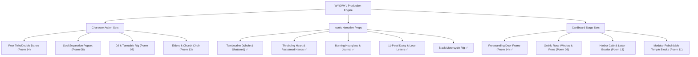

# WYGWYL: Poems, Footage & Puppet Engineering Blueprint

> **"Parts claim pixels in order: the forearm first, then the upper arm, then the head. Whatever is left is the body. Pivots go on the visible joint connectors."**

This document connects the **14 spoken-word poems**, the **1,367-clip footage archive** (3D Gaussian splats, pointclouds, and digital film passes), and the **cardboard puppet production pipeline**. It outlines what we need, our best elements, character action poses, iconic narrative props, and multiplane stage environments to elevate the paper-puppet film.

---

## 1. The Core Artistic Paradigm: The Hybrid Aesthetic

| Layer | Medium | Function in Film |
| :--- | :--- | :--- |
| **Atmosphere & Space** | 3D Gaussian Splats / Volumetric Pointclouds | The city's oppressive scale, sodium haze, rain on asphalt, light gates, water reflections. |
| **Performers & Soul** | Gouache on Corrugated Cardboard | Tangible, fragile, handmade human presence with visible kraft edges and fluting. |
| **Motion & Rigging** | Physical Brass Split-Pin Brads & Eyelets | Legible mechanical articulation; Lego-style modular swap system; zero AI hallucination. |

---

## 2. Poem-by-Poem Breakdown: Footage vs. Puppet Reality

### Poem 01: OUT OF LIFE
* **District:** Naraka Market (Twilight, 19:00–20:30, teal haze, light rain).
* **Narrative Core:** *"The maze, the haze, the fall, the ember... I move toward the window — and you only get further away... You fall off the fire escape, into darkness — and the city streaks upward."*
* **Archive Footage Reference:**
  - `8519865f_2` & `c1eadbdf_2`: Naraka alleyway neon flickering through drifting vapor.
  - `codex_01_Out_of_Life.mp4`: Downward camera rush along fire escape rungs.
* **Puppet Needs:**
  - **POET:** Black t-shirt costume (`poet.black_tshirt`). Pose: Reaching forward toward window in panic.
  - **EX:** Bomber jacket seen from behind (`ex.ex_jacket.body.back`), holding vape pen with rising smoke card. Pose: Falling backwards into the abyss.
  - **Props:** Vape pen with blue/grey cotton smoke card; fire escape iron railing card; window sash.
  - **Stage Layers:** Background teal alleyway splat; midground corrugated fire escape ladder; foreground dark sill.

---

### Poem 02: FLASHING LIGHTS
* **District:** The Overseer (Cold watchfulness, moonlit, sterile indigo, alarm crimson beacons).
* **Narrative Core:** *"The silent call a man makes to the mirror after midnight... I was six, I recall, when the ghost of a dead and love-less seven-year-old appeared... hands me a tambourine — and I throw it through the window."*
* **Archive Footage Reference:**
  - `MOUSSA_02-flashing-lights.mp4`: Silhouette of a man alone pacing before cold indigo windows with strobing red/blue light.
* **Puppet Needs:**
  - **YOUNG POET (Age 6):** Striped shirt and shorts (`young_poet.young_poet_child_clothes`), looking up in awe.
  - **GHOST CHILD (Age 7):** Ethereal pale nightclothes (`ghost_child.ghost_nightclothes.replacements`), drifting horizontally, holding out a tambourine.
  - **Props:** The Brass Tambourine with golden jingles (`props.narrative.master`); bedside mirror frame; Venetian blinds.
  - **Action:** Ghost Child handing tambourine; Young Poet flinging tambourine horizontally through shattered glass.

---

### Poem 03: HOW TO BREAK OFF AN ENGAGEMENT
* **District:** Mirror Thread Bay (Drowned rooms remembered, turquoise water, bioluminescence).
* **Narrative Core:** *"Ode to forever — a tambourine sounds off an empty temple... flies in through the rose window — still whole... rains until nothing remains... Ode to two sets of mud-imprinted footsteps... And a tambourine, shattered into pieces."*
* **Archive Footage Reference:**
  - `WGY030_DS__The_storm`: Ruined chapel interior with rain pouring through broken gothic tracery; water pooling on ancient floors.
* **Puppet Needs:**
  - **POET:** Black t-shirt, walking slowly with head bowed, tracing footsteps in mud.
  - **Props:** 
    - Cardboard Rose Window with broken stone tracery.
    - Whole Tambourine tumbling in air.
    - Shattered Tambourine (3 separate jagged cardboard shards, washed ashore on sand).
    - Wet gift boxes with unravelled ribbons.
  - **Stage Layers:** Gothic archway cutout; puddle plane reflecting broken window; mud shore.

---

### Poem 04: NEVERMORE
* **District:** Mirror Thread Bay (Ashes of expired wildfires, black sands, moonlit night garden).
* **Narrative Core:** *"To where the broken pieces have washed ashore... to find a throbbing heart — it used to be mine. I lift it with care: nevermore... search the bare ground for two hands... They too used to be mine. I put them back on."*
* **Archive Footage Reference:**
  - Drone footage over volcanic black sand dunes with foam bioluminescence and scattered debris.
* **Puppet Needs:**
  - **POET:** First appearance of the **Red/Black Outfit & Sunglasses** (`poet.red_black_sunglasses`).
  - **Poses:** Deep crouch sifting black sand; kneeling holding the heart in two cupped palms; pinning severed hands back onto wrists.
  - **Props:**
    - The Throbbing Heart: Gouache red/terracotta corrugated card with visible flutes and central brass brad.
    - The Reclaimed Hands: Pair of severed cardboard hands with wrist tabs ready to join forearm grommets with brass split-pins!
    - Golden blooming mustard seed plants that physically turn toward camera on brad pivots.

---

### Poem 05: BLOODLINES
* **District:** The Ascent (High altitude, cosmic spire, marble gates, ancestral choir).
* **Narrative Core:** *"Now go, they tell me. To ask if I can inherit the earth — to ask if I can name my own stars... mattress pads where the wood beams of Southern pine could comfort my spine... Their blood flows through my hands... The gates open with wings."*
* **Archive Footage Reference:**
  - `05a0677a_3`: Hidden stairwells with ancestral family crests; ascending crane shots into starry nebulae.
* **Puppet Needs:**
  - **POET:** Reaching upward, arms spread wide to the heavens.
  - **ANCESTORS:** Tall, robed figures in indigo and gold (`ancestors.ancestor_robe_indigo_gold`) and silver-white.
  - **Props:** Southern pine rafters; glowing star charts; celestial winged marble gates.

---

### Poem 06: RESURRECTING ATLANTIS
* **District:** The Light Gate & Atlantis Central Plaza (Threshold, dazzling white glare, architecture emerging from water).
* **Narrative Core:** *"A city comes up out of the water... Resurrecting Atlantis. Here we are all one... An unfamiliar, flickering candle light, illuminating smiles at night... narrow streets beaming with love... Leaving behind crosshairs for continuums."*
* **Archive Footage Reference:**
  - `codex_06_Resurrecting_Atlantis.mp4`: Submerged city spires rising out of turquoise seas; white marble plazas catching golden dawn light.
* **Puppet Needs:**
  - **ATLANTIS CITIZENS & GATEKEEPERS:** Cardboard figures in draped linen robes.
  - **Props:** Single flickering candle in brass holder; architectural crosshairs that rotate into continuum infinity symbols; stone gate lintel.

---

### Poem 07: DJ TURN ME UP
* **District:** Naraka Market (Open-mic basement, neon signage, sun-soaked memory vineyards).
* **Narrative Core:** *"DJ, turn me up, please. Eyes wide shut, chin nested at the arch of the weight of these spoken words... wedding bands diverging across abstract skies... eleven years — each plunkled off as daisy petals. We love, we not."*
* **Archive Footage Reference:**
  - Intimate handheld footage in dim club booth, glowing tube amp meters, crowd silhouettes swaying to low frequencies.
* **Puppet Needs:**
  - **POET:** Standing before microphone, chin nested high, right hand gesturing passionately.
  - **THE DJ:** Headphone on one ear, hand on turntable vinyl.
  - **Props:**
    - The 11-Petal Daisy (`props.narrative.master`): Cardboard flower with individually detachable petals.
    - Vintage dynamic microphone on cast-iron stand.
    - Pair of diverging gold wedding bands linked with clear wire.
    - Two moving cardboard moving trucks heading down opposite one-way arrows.

---

### Poem 08: NEWLY SINGLE
* **District:** Ankhu Spires (Crowded dance floor, equatorial planet, salted ice baths).
* **Narrative Core:** *"Pulsing, and head throbbing... The soul escapes my body, and leaves him on the dance floor — just flesh and bones... put my soul in the middle of an open field — at the equator of a planet much larger than my own... pouring unfiltered water out of ice baths, salted from the closest moons... Now bring my soul back to my body."*
* **Archive Footage Reference:**
  - `06881630_0`: High-altitude obsidian towers with violet neon lights; strobe dance sequences.
* **Puppet Needs:**
  - **POET (The Flesh Body):** Jointed cardboard puppet slumped or frozen in a trance dance posture.
  - **POET'S SOUL (The Astral Puppet):** Translucent paper cutout duplicate that physically unpins from the torso brad and floats into the sky.
  - **Props:** Deep wooden tub with cardboard ice blocks and blue moon salts; smoke clouds.

---

### Poem 09: YET, HEARD
* **District:** The Shrouded Arcade & Inner Harbor (Memory corridor, chrome, rain, three farewell calls).
* **Narrative Core:** *"Three calls before leaving: 1) Before I go, we look at the moon... 2) Before I go, I call on my mother — in tears, speaking of an abyss... 3) Before I go, I call on my father — his calming demeanor... We walk for years, east toward the sunrises, retracing his footsteps... Someone borrowed, and someone blue — yet, broken. Yet, heard."*
* **Archive Footage Reference:**
  - Rain-slick arcade, coin-operated phone booth with amber bulb, harbor pier at 5:00 AM dawn.
* **Puppet Needs:**
  - **THE MOTHER (`parents.elders`):** Older woman seated in floral wingback armchair, weeping with cream phone receiver to ear.
  - **THE FATHER (`parents.elders`):** Older man in long grey coat and flat cap, walking with wooden cane.
  - **POET:** Holding armored payphone handset; strolling beside his father matching footsteps.
  - **Props:** Steel armored payphone; cream rotary home phone on nightstand; rolling suitcase.

---

### Poem 10: MAGIC RIDE
* **District:** The Orange Haze (Dense orange smog, sodium vapor lamps, industrial skyway viaducts).
* **Narrative Core:** *"I let the noise block the noise. The way I ride: eyes turn, heads twist — and prove the magic still exists. All preparations to live and dream in darkness, I no longer desire... riding into a morning I could believe in."*
* **Archive Footage Reference:**
  - `11929669_0` & `31ca5420_1`: Blade Runner 2049 orange haze brutalist skyways, elevated steel bridges.
* **Puppet Needs:**
  - **THE MOTORCYCLE (`vehicle.motorcycle`):** Black cafe racer with spoked wheels on brass axle brads, fuel tank with split-pin mounts.
  - **POET (Riding Poses):** Low tuck over the tank in profile; leg swung over seat; standing beside bike at dawn.
  - **Props:** Glowing yellow round headlight card; speedometer dial; exhaust plume card.

---

### Poem 11: NEW DAY
* **District:** Cenotaph Rail (Dawn fog over seas, white stone temple being rebuilt course by course).
* **Narrative Core:** *"Fog covers the seas and hugs the tree-covered hills... In the awakening of dawn, in fresh muted colors: we can rebuild this temple... columns and beams... laps around infinity pools of edgeless dreams... that we too can walk on water."*
* **Archive Footage Reference:**
  - `08fe12af_0`: Brasilia Itamaraty Palace pools, white marble colonnades reflecting pale dawn skies.
* **Puppet Needs:**
  - **POET:** Seated on white stone block opening his worn leather journal.
  - **TEMPLE STAGE PIECES:** Modular interlocking white cardboard stone blocks that stack on guide pins to rebuild the sanctuary on camera.
  - **Props:** Worn leather-bound journal with handwritten pages; stone mason's plumb line and chisel.

---

### Poem 12: REUNION
* **District:** The White Temple & its Pools (Decades compressed, warm hall light, brotherhood).
* **Narrative Core:** *"Decades later, there is less time for words, and more space for laughter — hugs with no reason, and loud voices, so our hearts can be overheard... of elders, now past. And is this a one-time occasion? we ask. Or will we make time, in the sands of burning hourglasses?"*
* **Archive Footage Reference:**
  - Warm sunlit marble terrace with turquoise infinity pool; groups of friends laughing and embracing in slow motion.
* **Puppet Needs:**
  - **POET & BROTHER:** Embracing in a deep three-quarter hug with arms locked.
  - **THE ELDERS:** Silhouettes in backlit linen robes.
  - **Props:**
    - The Burning Hourglass (`props.narrative.master`): Hand-sized hourglass with flame at the neck and running golden sand.
    - Worn leather American football.
    - Smartphone displaying archival 1990s polaroid snapshot of the brothers young.

---

### Poem 13: HOW TO WIN MY HEART
* **District:** Mirror Thread Bay (Harbor small tables, orbiting couples, burning letters).
* **Narrative Core:** *"Find me at the harbor, at the small tables, watching. The couples orbit each other the way Jupiter keeps its moons... The elders clutch their pearls and pray. Life has burned all my love stories... So I harvest the flowers instead — scarlet poppies, purple blossoms — and they become my power. Then, a distant window. She says: you won't leave."*
* **Archive Footage Reference:**
  - `22fcebea_1`: Waterfront cafe with small round tables, lanterns, distant illuminated apartment window across the bay.
* **Puppet Needs:**
  - **POET:** Sitting at cafe table, feeding love letters one by one into an iron brazier; gathering armful of poppies.
  - **THE WOMAN (`woman.window_woman_dress`):** Red summer dress in distant lit window frame, hand raised in welcome.
  - **COUPLES & ELDERS:** Slow dancing couple; elder woman clutching pearl necklace and rosary.
  - **Props:**
    - Small round cafe table and wire chair.
    - Heap of burning love letters with scorched edges (`props.narrative.master`).
    - Scarlet poppies and purple blossom stems.
    - Pearl necklace and rosary bead loop.

---

### Poem 14: HOT MINUTE
* **District:** The Ascent (Everything built learns to be weather, the film reel flash, the vintage door).
* **Narrative Core:** *"A hot minute. The haze gathers on the water — and everything I built here learns to be weather: the city, the temple, the harbor. It takes me last, and from the ground up... A life flashes the way a reel does: the window, the tambourine, the field, the stars, the candle, the daisy, the ride, the temple, the hourglass... Our dance together is a victory — two entwined muses... An old door, from a vintage somewhere. It opens on a slow party... This time, I choose the door."*
* **Archive Footage Reference:**
  - `36c9c157_3`: Golden particles ascending into deep indigo night; life montage dissolving into blinding warm porch light.
* **Puppet Needs:**
  - **POET & THE DOUBLE:** Two identical Poet puppets dancing together, hands clasped, turning in synchronization.
  - **Props:**
    - The Film Reel Flash: Rapid miniature cardboard cards of all previous 13 key props (window, tambourine, field, stars, candle, daisy, motorcycle, temple, hourglass).
    - The Vintage Door (`props.narrative.master`): Old panelled wooden door with brass knob in its own freestanding frame, opening on brass hinges to reveal warm golden party light within.
    - Champagne coupes held by 1940s vintage party guests.

---

## 3. What We Are Needing: The Missing Elements Action List

---

## 4. Current Repository Status & Next Deployments

* **Rendered Sheets:** 17 master sheets completed and cataloged in `shots/arena/parts/kit3/v2/rendered/`.
* **Cut Modular Parts:** 140 transparent PNG parts with automatic brass brad and eyelet coordinate detection in `shots/arena/parts/kit3/v2/cut/`.
* **Catalog & Viewer:** Live interactive explorer with filtering, inspection, and direct downloading in `shots/kits.html`.
